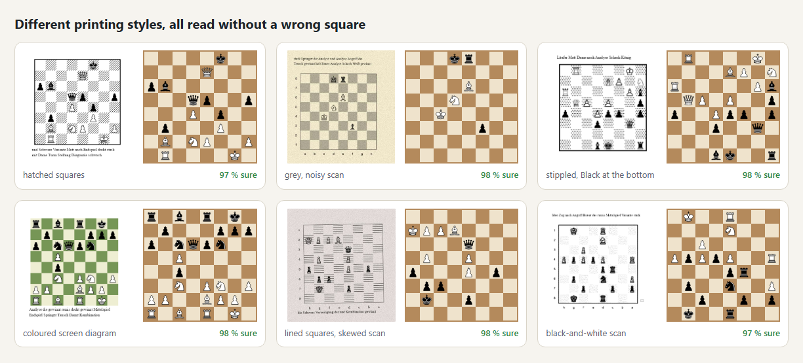
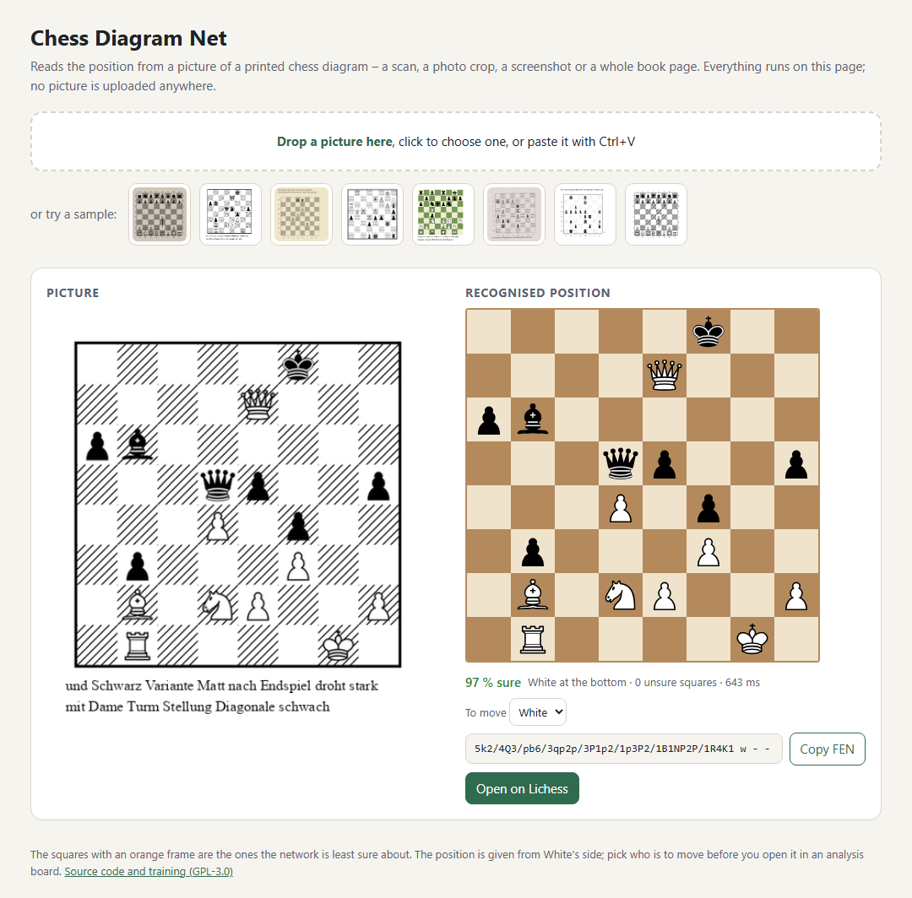
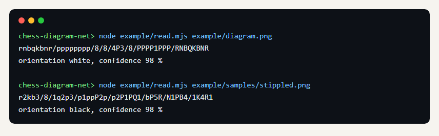

# Chess Diagram Net

Liest die Stellung aus dem Bild eines gedruckten Schachdiagramms, offline und in reinem JavaScript. Ein kleines
faltendes Netz bestimmt für jedes Feld, ob es leer ist oder welche der zwölf Figuren darauf steht. Der Code darum
findet das Brett, bereinigt die Felder und prüft das Ergebnis an den Schachregeln.

Es stammt aus der Diagrammerkennung des E-Book-Readers Cozy Shelves (Fassung 0.10.2) und läuft ohne ihn.
[English version](README.md)

## Genauigkeit



Von 1309 Diagrammen aus 23 Schachbüchern, die das Netz beim Training nie gesehen hat, liest es 94,9 % ohne ein
einziges falsches Feld. Die Bücher haben schraffierte, graue, gepunktete und einfarbige dunkle Felder, Rahmen,
Koordinaten und Pfeile, und Scans sehr unterschiedlicher Güte.

## Benutzung

### Im Browser – ohne Programmieren



`example/demo.html` ist eine kleine Seite zum Ausprobieren. Bild darauf ziehen, mit Strg+V einfügen oder eines der
Beispiele wählen. Sie zeigt die erkannte Stellung neben dem Bild, rahmt die Felder orange ein, bei denen sie am
unsichersten ist, und gibt dir die FEN zum Kopieren oder einen Knopf, der die Stellung im Analysebrett von Lichess
öffnet. Sie liest ein einzelnes Diagramm genauso wie eine ganze Buchseite mit bis zu zwei Diagrammen, und kein Bild
verlässt deinen Rechner.

Die Seite lädt die Erkennung als JavaScript-Module, deshalb muss sie von einem Webserver kommen und nicht als
doppelt geklickte Datei. Jeder kleine Server reicht, zum Beispiel mit Python:

```
git clone https://github.com/regard2462/chess-diagram-net.git
cd chess-diagram-net
python -m http.server 8000
```

Dann <http://localhost:8000/example/demo.html> öffnen. Ohne git auf GitHub *Code → Download ZIP* wählen und den
Server im entpackten Ordner starten; mit Node geht statt Python auch `npx serve`.

Am besten: ein Diagramm mit etwas weißem Rand, gerade von vorn. Scans, Bildschirmfotos, JPEG-Bilder und leicht
schief eingescannte Seiten gehen, siehe die Stile oben.

### Auf der Kommandozeile



Node 18 oder neuer, ohne Abhängigkeiten, PNG-Bilder:

```
node example/read.mjs example/diagram.png
```

gibt aus:

```
rnbqkbnr/pppppppp/8/8/4P3/8/PPPP1PPP/RNBQKBNR
orientation white, confidence 98 %
```

### Im eigenen Code

```js
import { fromRGBA } from './diagram/image.js';
import { recognize } from './diagram/recognize.js';

const res = recognize(fromRGBA(rgbaBytes, width, height));
// res.placement: Figurenstellung als FEN aus Sicht von Weiß
// res.orientation: 'white' oder 'black' (welche Seite unten im Bild steht)
// res.confidence: Wahrscheinlichkeit, dass die ganze Stellung stimmt
// res.squares[i].conf, res.uncertain: je Feld
```

Das Bild sollte das Diagramm mit etwas Rand zeigen. `diagram/find-boards.js` findet bis zu zwei Bretter auf einer
ganzen Seite (`findBoardsInPixels`, die Demo nutzt es). Die Erkennung braucht auf der CPU weniger als eine Sekunde je
Diagramm und läuft auch im Browser oder in einem Web Worker. Wer am Zug ist, Rochaderechte und Zugnummer stehen nicht
im Diagramm; die Demo ergänzt `w - - 0 1` und lässt dich auf Schwarz umstellen.

## Inhalt

| Ordner | |
| --- | --- |
| `diagram/` | die Erkennung: Brettsuche (`locate.js`), Feldanalyse (`squares.js`), Pfeile, das Netz (`net.js`, Gewichte in `net-weights.js`, 102 KB, int8), die Entscheidung mit den Schachregeln (`decode.js`, `recognize.js`) |
| `training/` | Erzeuger für künstliche Diagramme, Auszug der Trainingsfelder, Training, Messung, Feinabstimmung |
| `example/` | die Browser-Demo (`demo.html`, mit den cburnett-Figuren in `pieces.js` zum Zeichnen des Ergebnisses), das Kommandozeilenbeispiel (`read.mjs`) und Beispielbilder in `samples/` |

## Training

Das Netz hat an etwa 890.000 Feldern gelernt: an erzeugten Diagrammen in vielen Figurensätzen, Brettstilen und
Verschlechterungen und an geprüften Feldern aus Diagrammen echter Schachbücher. Die Bücher selbst gehören nicht zu
diesem Repository. Die Werkzeuge für beide Arten von Daten liegen in `training/`, jede Datei erklärt oben ihre
Benutzung.

Für erzeugte Daten braucht es Python 3 mit Pillow, PyMuPDF und python-chess sowie die cburnett-Figuren von
chessground (`npm install chessground@9.2.1`). Die Schachzeichen der Windows-Schriften werden genutzt, wenn sie da
sind. Das Training braucht PyTorch, für kleine Läufe reicht die CPU.

```
python training/gen_chess.py book data/book 2000
node training/extract.js data/book data/book-shard
python training/train.py data/book-shard --epochs 20 --out diagram/net-weights.js
python training/gen_chess.py book data/test 300
node training/bench.js data/test
```

Echte Bücher: `training/harvest.py` rendert die Seiten eines Ordners voller PDFs und sammelt die Bretter
(`scan-books.js`), `label.py` gruppiert die Felder nach ihrem Aussehen und schreibt Bögen zum Prüfen von Hand,
`pack.py` macht aus den geprüften Feldern Trainingsdaten und Testdiagramme.

## Lizenz

AGPL-3.0-or-later, siehe [LICENSE](LICENSE). Die cburnett-Figuren, die der Erzeuger nutzt, stammen von Colin M.L.
Burnett (GPL-2.0-or-later) und kommen mit chessground (GPL-3.0-or-later); die Demo zeichnet das Ergebnis mit denselben
Figuren. Die Beispielbilder stammen aus dem Erzeuger. Die Gewichte enthalten keine Schriftdaten.
